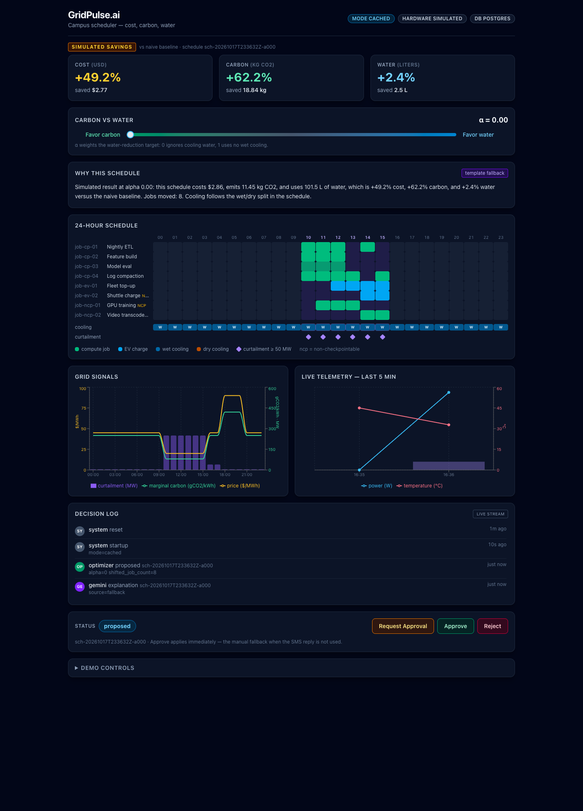
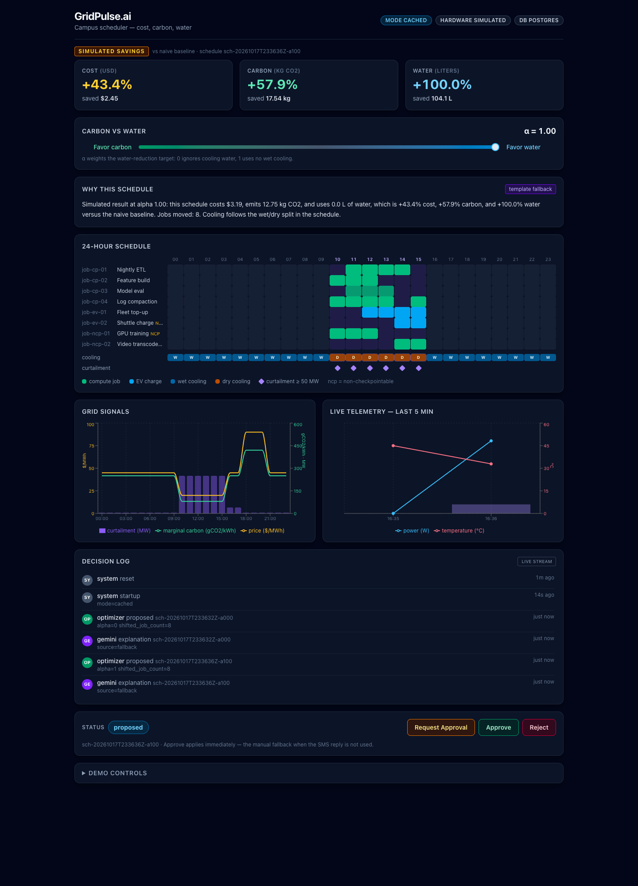
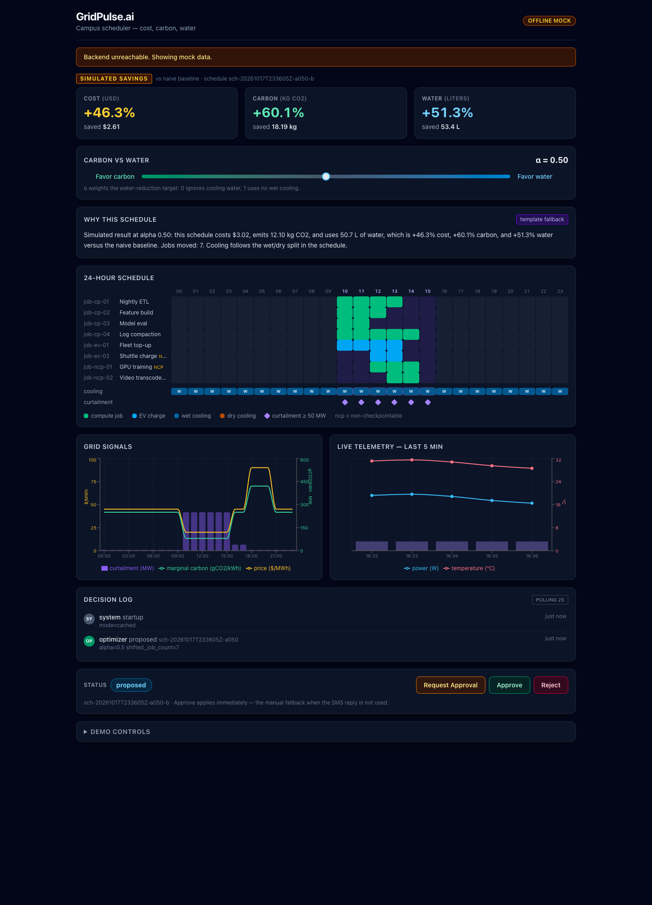

# GridPulse.ai — Frontend

React dashboard for the GridPulse.ai campus scheduler (SPEC.md sections 5, 6, 15).
Dark mode only, tuned for projector readability. Runs fully on mock data with
no backend, and switches to the real API with one env var.

## Run

```bash
npm install
npm run dev        # http://localhost:5173
```

Backend on or off, the page loads:

- `VITE_API_URL` set and `GET /api/health` answers -> live data.
- Health check fails (or the env var is unset) -> the banner
  "Backend unreachable. Showing mock data." appears and every panel renders
  from the in-browser mock client (`src/mock/`), including a simulated
  optimize/approve/reject lifecycle.

`.env` contains only:

```bash
VITE_API_URL=http://localhost:8000
```

That is the only backend base URL. No request goes anywhere else.

## Other commands

```bash
npm test           # Vitest + Testing Library (FE-1..FE-3)
npm run build      # tsc + vite build
npm run lint       # oxlint
```

## Panels (SPEC 15)

Header badges from `/api/health` (mode, hardware_mode, database) · KPI cards
(cost / carbon / water vs baseline, `SIMULATED SAVINGS` tag) · alpha slider
(`Favor carbon` / `Favor water`, 250 ms debounce -> `POST /api/optimize`) ·
Gemini explanation card · 24-hour Gantt with cooling strip and curtailment
overlay · signals chart (price, marginal carbon, curtailment) · live telemetry
(last 5 min, fan markers) · decision log (SSE `/api/stream`, falls back to
2 s polling) · schedule action bar (Request Approval / Approve / Reject) ·
collapsed demo controls (Trigger Surplus, Reset).

`?alpha=0.75` deep-links the first optimize call — used for the screenshots
below.

## Screenshots

Alpha 0 — wet cooling everywhere, cost/carbon optimized:



Alpha 1 — dry cooling only, water savings +100%:



Offline fallback (no backend):



Retake them with:

```bash
node scripts/screenshot.mjs "http://localhost:5173/?alpha=0" screenshots/alpha-0.png
node scripts/screenshot.mjs "http://localhost:5173/?alpha=1" screenshots/alpha-1.png
```

(requires Chrome at `/Applications/Google Chrome.app` — adjust the path in
`scripts/screenshot.mjs` if needed.)

## Layout

```
src/
  api/types.ts     SPEC section 5/6 JSON types, snake_case exactly
  api/client.ts    typed fetch client (VITE_API_URL) + ApiClient interface
  mock/            fixtures + offline client implementing the same interface
  components/      one file per panel
  hooks/           decision feed (SSE -> 2 s poll), telemetry poller
  utils/format.ts  units: USD, kg CO2, L, %, PT-hour labels, relative time
  test/            Vitest specs for FE-1, FE-2, FE-3
```

Savings numbers are simulated end to end (`savings_label: "simulated"`).
